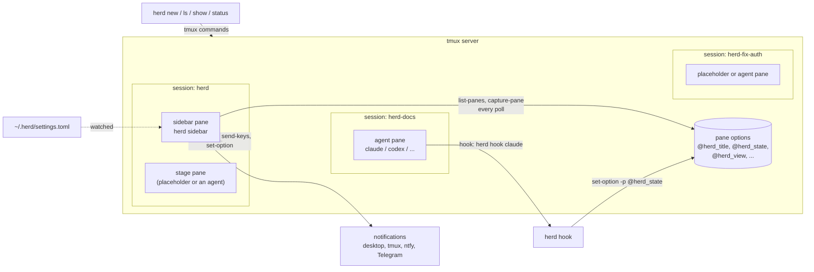
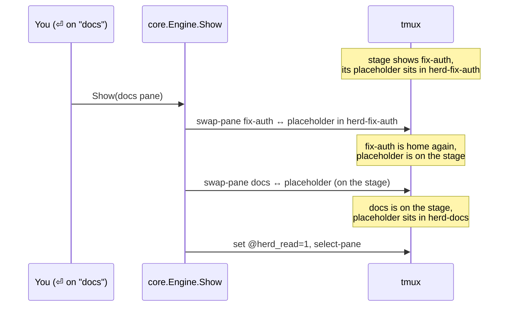
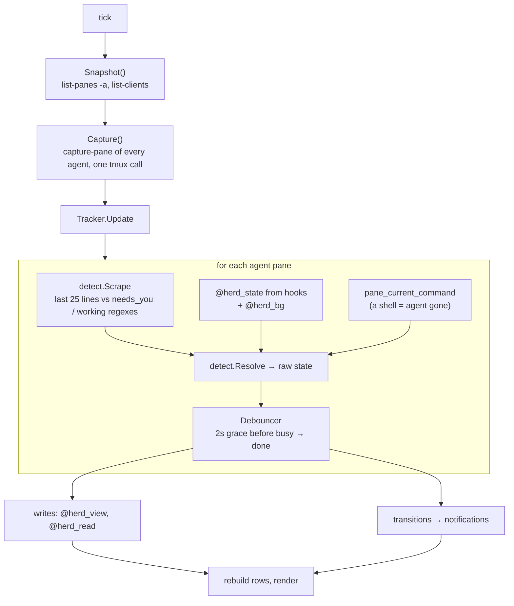

# Architecture

This page is for people who want to change herd. It explains how the parts fit together. For how to use herd, see the [README](../README.md).

## The short version

- herd is one Go binary. The same binary is the CLI, the sidebar, the placeholder pane and the agent hook. The first argument picks the role.
- tmux does the heavy work. herd never draws an agent's screen itself; it moves tmux panes around and reads them.
- **All state lives in tmux options** (`@herd_*` on panes, sessions and the server). There is no database, no daemon and no socket of herd's own. Any herd process can stop at any time, and the next one carries on from what tmux holds.
- State comes from two sources: **hooks** that the agents call, and **screen scraping** that the sidebar does about once a second. The sidebar merges them into the state you see.



## Code layout

| Path | What it does |
|---|---|
| `cmd/herd/main.go` | Entry point. Parses the subcommand (`new`, `ls`, `status`, `hook`, `sidebar`, `update`, ...) and calls into the packages below. |
| `cmd/herd/placeholder.go` | The `herd placeholder` process: a quiet pane that holds a slot (see [Layout](#layout-sidebar-stage-and-placeholders)). |
| `internal/tmux` | Thin wrapper around the `tmux` command: `Run`, `Batch` (several commands in one call, joined with `;`), list clients, quoting. `HERD_TMUX_SOCKET` picks a private server for tests. |
| `internal/model` | The data model: `Pane`, `State`, and the names of every `@herd_*` option. `ListPanes` reads all panes and their options in one `list-panes -a -F` call. |
| `internal/core` | The engine. Layout (create, repair), showing an agent on the stage, creating, closing, renaming, grouping and reordering agents, adoption. `Tracker` turns observations into shown states and notifications. `Capture` reads the screens of all agents in one tmux call. |
| `internal/detect` | Pure logic that decides an agent's state: `Scrape` (screen text → state), `Resolve` (hook state + screen + process → state) and `Debouncer` (smooths flicker). |
| `internal/hook` | `herd hook claude` and `herd hook codex`. Maps hook events to states and writes them to `$TMUX_PANE`. Reads Claude transcripts to count background shells and subagents. |
| `internal/ui` | The sidebar: a [Bubble Tea](https://github.com/charmbracelet/bubbletea) program. Polling, rows, keys, dialogs, preview, folder and skill completion. |
| `internal/config` | Loads `~/.herd/settings.toml`, fills in built-in agents, and watches the file for changes. `Store` holds the current config behind an atomic pointer. |
| `internal/gitwt` | Git helpers: create and remove worktrees, branch and head, diff stats. |
| `internal/notify` | Desktop (`terminal-notifier` / `osascript` / `notify-send`), tmux `display-message`, and push (ntfy, Telegram). Decides when you are "away". |
| `internal/install` | Adds and removes herd's hooks in `~/.claude/settings.json` and `~/.codex/config.toml`, with a backup. |
| `internal/limits` | Reads the limit rings JSON file. |
| `internal/selfupdate` | `herd update`: download a release from GitHub or `go install` a ref, then replace the running binary. |

Dependencies point one way: `cmd/herd` → `ui` → `core` → `detect`, `hook`, `gitwt`, `model` → `tmux`. `config` is used by most packages. Nothing under `internal` imports `ui` or `cmd`.

## One binary, many roles

| Command | Runs where | Lifetime |
|---|---|---|
| `herd`, `herd new`, `herd ls`, `herd show`, ... | your shell | short: does its tmux calls and exits |
| `herd sidebar` | left pane of the `herd` session | long: the Bubble Tea UI |
| `herd placeholder` | the stage, or an agent's home session | long: draws a short message, ignores keys |
| `herd hook claude` / `herd hook codex` | inside the agent's pane, started by the agent | very short: one event, then exit |

`main` handles `hook` before anything else: hooks do not load the config, never print, recover from panics and always exit 0, so a herd bug can never break an agent.

Because the sidebar and placeholder are started by tmux with the absolute path of the binary (`Engine.Self`), `herd update` only needs to replace the file and restart the sidebar pane (`RestartSidebar`, which uses `respawn-pane`).

## State in tmux options

`internal/model/model.go` lists every option. The important ones:

| Option | Scope | Meaning |
|---|---|---|
| `@herd_role` | pane | `sidebar` or `placeholder`. Agent panes have none. |
| `@herd_agent` | pane | Agent kind (`claude`, `codex`, `shell`, or your own). A pane with this set and no role is an agent. |
| `@herd_title`, `@herd_group`, `@herd_order` | pane | What the sidebar shows and in which order. `order` is a float so a move only rewrites one pane. |
| `@herd_home` | pane | The agent's own session (`herd-<slug>`), where it goes back to when it leaves the stage. |
| `@herd_dir`, `@herd_repo`, `@herd_worktree`, `@herd_branch`, `@herd_base` | pane | Where the agent works, and the commit its diff is measured against. |
| `@herd_state`, `@herd_state_ts` | pane | Raw state written by **hooks**. |
| `@herd_hooked`, `@herd_transcript`, `@herd_bg`, `@herd_bg_kinds` | pane | Hook bookkeeping: hooks are active, transcript path, running background work. |
| `@herd_view`, `@herd_view_ts` | pane | State **shown** in the sidebar, written by the sidebar. Lets a restarted sidebar continue without blinking. |
| `@herd_read`, `@herd_inactive` | pane | Unread dot (•) and "set aside" (☾). |
| `@herd_adopt` | session | Set it to `1` and the sidebar adopts the session as an agent. |
| `@herd_groups`, `@herd_collapsed`, `@herd_keys` | server (`-g`) | Group order, folded groups, and the key bindings herd added (so they can be removed). |

Pane options move with the pane on `swap-pane`, so an agent keeps all its data wherever it is shown.

Every read starts from `Engine.Snapshot()`: one `list-panes -a` with a format string that returns all panes and all `@herd_*` options, plus `list-clients` and the global options. Writes are collected and sent with `Batch`, so one sidebar tick costs a handful of tmux calls no matter how many agents there are.

## Layout: sidebar, stage and placeholders

The main session (default `herd`) has one window with two panes: the sidebar on the left and the **stage** on the right. Every agent lives in its own session, `herd-<slug>`.



- Showing an agent is `swap-pane`, not a restart. The process, its scrollback and its size stay as they are.
- A `herd placeholder` pane fills the hole the agent leaves, so the agent's session never becomes empty (tmux would destroy it).
- **Invariant:** the placeholder is either on the stage, or in the home session of the agent that is on the stage. `homeSlot` creates a placeholder in the home session when one is missing.
- `Engine.Repair` runs on startup and every two seconds from the sidebar. It recreates a missing sidebar or stage, fixes the sidebar width, and kills sessions that hold only placeholders (left over when an agent exited while it was shown).
- `herd quit` / `Q` first sends the staged agent home, then kills the main session, so no agent dies with it.

## Starting an agent

`Engine.NewAgent` (used by `n` in the sidebar and by `herd new`):

1. Resolves the agent kind and folder, and picks a free session name `herd-<slug>` (`-2`, `-3`, ... on clashes).
2. If the folder is in a git repo and worktrees are on, `gitwt.Add` creates a worktree under `worktree_dir` on a new branch `branch_prefix + slug`. If the folder was a subfolder of the repo, the agent starts in the same subfolder of the worktree.
3. Creates the session with `new-session -d`, sized like the stage so the agent's first screen fits.
4. In one `Batch`: sets the `@herd_*` options, then types the agent command (plus the quoted first prompt) with `send-keys`.

The agent runs inside a normal shell. When it quits you are left at the shell prompt, which is how herd detects "exited".

## How a state is decided

Every poll (`sidebar.poll`, default 1s) the sidebar runs this loop:



`detect.Resolve` applies these rules, in order:

1. `shell` agents: working while a command runs, done at the prompt.
2. The pane is back at a shell prompt: **exited** (after a 5 second start grace, while the agent command is still being typed). If the screen shows a prompt that needs you, that wins.
3. Hooks are active: use the hook state, but
   - the screen saying **needs you** wins (approval prompts appear before the `Notification` hook),
   - hook says needs you but the screen shows work: **working** (you already answered),
   - hook says done but background work is still counted: **background**, and the reverse.
4. No hooks: use the scraped state.

The `Debouncer` only delays leaving a busy state (working or background → done). Spinners and status lines blink, so an agent must look idle for 2 seconds before it is called done. Every other change is shown at once.

While an agent is in **background**, the tracker re-reads its transcript every 5 seconds (`hook.CountBackgroundFile`) and flips it to done when the last background shell or subagent ends.

### Hooks

`herd install-hooks` registers `herd hook claude` for Claude Code's `SessionStart`, `UserPromptSubmit`, `PreToolUse`, `PostToolUse`, `Notification`, `Stop`, `SubagentStop`, `PreCompact` and `SessionEnd`, and `notify = ["herd", "hook", "codex"]` for Codex.

The hook reads the event, maps it to a state (`hook.ClaudeUpdate`), and writes options on `$TMUX_PANE` in one tmux call. On `Stop` it reads the transcript to count background work. Set `HERD_HOOK_LOG` to a file path to log every call.

Hooks and scraping complement each other: hooks are exact and cheap, scraping sees approval prompts sooner and works for any agent that has rules in the config.

## Unread marks and notifications

`Tracker.Update` also decides what you have seen. A pane is **seen** when it is the active pane of some tmux client, or it is on the stage while a client is attached to the main session.

When the shown state changes into one that wants attention (needs you, done, exited) and you are not looking at it, the pane gets `@herd_read=0` and a `Transition` is produced. The sidebar turns transitions into notifications:

- skipped for set-aside agents and for states not in `notify.on`,
- at most one per agent and state every 10 seconds,
- tmux message and desktop notification as configured,
- phone push only when no tmux client has had input for `away_after`.

Notifications are sent by the sidebar, so they only fire while the herd window exists (attached or not).

## The sidebar

`internal/ui` is a standard Bubble Tea model (`Init` / `Update` / `View`). Anything that talks to tmux or git runs as a `tea.Cmd` off the UI goroutine and reports back as a message:

| Message | Sent by | Does |
|---|---|---|
| `tickMsg` | poll timer | starts a fetch (skipped if one is still running) |
| `snapMsg` | fetch | runs the tracker, writes state, sends notifications, rebuilds rows |
| `animMsg` | 120 ms timer | spinner frame |
| `diffMsg` | every 10 s | `git diff --shortstat` per agent against `@herd_base` |
| `actionMsg` | any key action (show, close, rename, ...) | shows a message, refetches at once |
| `ConfigMsg` | file watcher | swaps in the new settings |

Layout repair and adoption also run from `applySnapshot`, at most every two seconds.

## Settings

`config.Load` parses `~/.herd/settings.toml` on top of `config.Default()` and the built-in agents (`claude`, `codex`, `shell`), so every field is optional and partial `[agents.x]` tables keep the built-in rules they do not set. The sidebar watches the file (`config.Watch`) and swaps the new config into the `Store`; nothing needs a restart, except key bindings, which apply on the next `herd`.

## Testing

```sh
go test ./...
```

- `detect`, `hook`, `config`, `limits`, `install`, `notify` and `selfupdate` are mostly pure functions with table tests.
- `core` tests run against a real, private tmux server (`HERD_TMUX_SOCKET`), so they check actual pane swaps and options. They are skipped when tmux is not installed.
- `ui` tests feed snapshots and key messages straight into the Bubble Tea model, with no tmux server.
- `gitwt` tests create throwaway repos in a temp dir.

## Where to start for common changes

| You want to... | Look at |
|---|---|
| Support a new agent CLI | `config.BuiltinAgents` (command, `working` / `needs_you` regexes, approve/deny keys). No code needed for users: they can add `[agents.x]` in settings. |
| Change when a state is shown | `detect.Resolve`, `detect.Debouncer`, `core.Tracker` |
| Handle a new hook event | `hook.ClaudeUpdate`, and the event list in `internal/install` |
| Add a sidebar key | `internal/ui/ui.go` (`key`), help text in `view.go` |
| Add a CLI subcommand | `run` in `cmd/herd/main.go` |
| Store new per-agent data | add an `Opt*` constant and its entry in `paneVars` in `internal/model` (keep the field order in `ParsePanes` in sync) |
| Add a notification channel | `internal/notify`, config in `config.Push` |
